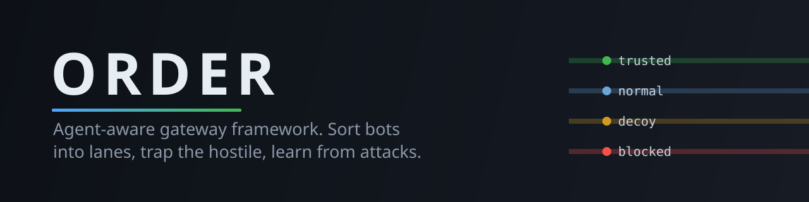
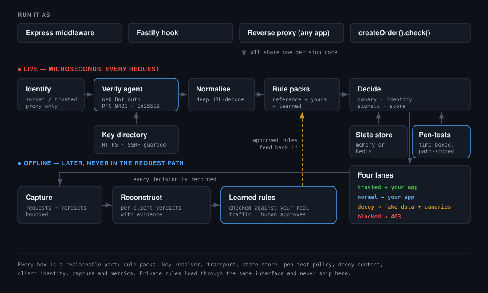

<div align="center">



# ORDER

**An agent-aware gateway framework for the age of AI bots.** Sort verified agents from hostile ones, trap the suspicious in a decoy, and learn from every attack — with evidence, not guesses.

Created by **[Keerthi Krishna Gamasany](https://github.com/keerthikrishnagamasany)**

[](LICENSE)
[](#requirements)
[](tsconfig.base.json)
[](#packages)

[Quickstart](#quickstart) · [Why ORDER](#why-order) · [Use it](#use-it-in-your-app) · [Signed agents](#signed-ai-agents-web-bot-auth) · [Learned rules](#learned-rules) · [Production](#running-it-in-production) · [Extending](EXTENDING.md) · [Architecture](#architecture)

</div>

---

> Traditional WAFs answer one question: *block or allow?* That binary breaks when a large and
> growing share of your traffic is **AI agents** — some you want (a partner's assistant calling
> your API), some you don't (a scraper wearing a browser's clothes). ORDER adds the missing
> axis: **who is this, and what are they trying to do?** — and it keeps the evidence so you can
> prove the answer.

ORDER is a **framework**: a complete, working baseline you can run today, built from parts you can replace. Rules, key discovery, state, decoy content, identity, capture and metrics all sit behind small interfaces. Start with the defaults; swap any part for your own. See **[EXTENDING.md](EXTENDING.md)**.

## Why ORDER

- **Four lanes, not two.** Every request is sorted into `trusted`, `normal`, `decoy` or `blocked`. A verified partner agent isn't treated like an anonymous scraper, and a scraper isn't treated like a user.
- **Cryptographically verified agents.** Agents that sign requests with [Web Bot Auth](#signed-ai-agents-web-bot-auth), the IETF standard, are admitted to `trusted`. Forged or replayed signatures are trapped.
- **A decoy that pays off.** Suspicious-but-unproven clients get convincing fake data seeded with **canary tokens**. If one is ever replayed, that is *provable* compromise — the one thing ORDER labels `CERTAIN`.
- **It learns, carefully.** From a captured session ORDER proposes [new detection rules](#learned-rules), each with its evidence, and rejects any rule that would also have hit your legitimate traffic. A human approves before anything goes live.
- **Fast and dependency-free.** About **2.8 µs per decision** ([benchmark](#performance)) and **zero runtime dependencies** in every package.

## Quickstart

```bash
git clone https://github.com/keerthikrishnagamasany/order.git
cd order
corepack enable && pnpm install
pnpm demo
```

```
client          path                          expect    actual    ok
------------------------------------------------------------------------
legit-user      /api/v1/products              normal    normal    PASS
partner-swift   /api/v1/orders                trusted   trusted   PASS
signed-agent    /api/v1/products              trusted   trusted   PASS   (Web Bot Auth)
replayed-sig    /api/v1/products              decoy     decoy     PASS   (signature for another host)
scanner-A       /.env                         blocked   blocked   PASS
probe-B         /api/v1/products              blocked   blocked   PASS   (encoded SQLi)
probe-C         /api/v1/assistant             decoy     decoy     PASS   (prompt injection)
pentest         /api/v1/products              trusted   trusted   PASS   (declared pen-test)
pentest         /.env                         blocked   blocked   PASS   (outside its scope)
...
15/15 landed in the expected lane
```

Then it reconstructs what each client was doing, and proposes rules from the capture:

```
pentest         CERTAIN   Authorized security test (Q4 pen-test) — attack payloads expected, allowed and logged
                LIKELY    Tester key used outside its authorized paths — blocked as a possibly leaked key
replayed-sig    LIKELY    Presented an agent signature that failed verification — forged, tampered or replayed
...
NEW       path /wp-json/wp/v2/users          LIKELY    2 clients, 0 false positives
REJECTED  user_agent swift-agent             would also match 1 trusted request(s) in this capture
```

The new rule is a path no built-in rule knows, probed by two different scanners. The
rejected one would have blocked a legitimate partner.

## Use it in your app

Every option below runs the same decision core, so they behave identically.

**Express**

```ts
import express from "express";
import { orderExpress } from "@order/gateway";

const app = express();
app.use(express.json());          // mount ORDER after your body parser so it can inspect bodies
app.use(orderExpress());          // attacks are answered here and never reach your routes
app.get("/api/items", (req, res) => res.json({ lane: res.locals.order.decision.lane }));
```

**Fastify**

```ts
import Fastify from "fastify";
import { orderFastify } from "@order/gateway";

const app = Fastify();
app.addHook("preHandler", orderFastify());
```

**In front of any app (reverse proxy)** — Rails, Django, Go, anything that speaks HTTP:

```ts
import { createGateway } from "@order/gateway";

const { server } = createGateway({ upstream: { url: "http://127.0.0.1:3000" } });
server.listen(8080);
```

Only `trusted` and `normal` traffic is forwarded. Blocked and decoyed requests are answered by ORDER and never reach your app. Request bodies are forwarded byte-for-byte; responses are streamed back. Your app receives `x-order-lane`, `x-order-client` and, for signed agents, `x-order-verified-agent` — and ORDER strips any copies a client tries to send itself.

**Your own server** — call the core directly:

```ts
import { createOrder } from "@order/gateway";

const order = createOrder();
const { decision, respond } = await order.check({ method, url, headers, body, remoteAddress });
if (respond) { /* ORDER answered: send respond.status / respond.body */ }
```

## Signed AI agents (Web Bot Auth)

`@order/web-bot-auth` implements the verifier side of
[draft-ietf-webbotauth-httpsig-protocol](https://datatracker.ietf.org/doc/html/draft-ietf-webbotauth-httpsig-protocol):
RFC 9421 HTTP Message Signatures, Ed25519 keys, RFC 8037 thumbprints as `keyid`, and the `web-bot-auth`
tag. It's tested against the **draft's own Ed25519 test vector**, so ORDER agrees with the standard,
not only with its own signer.

```ts
import { orderExpress, HttpsDirectoryResolver } from "@order/gateway";

app.use(orderExpress({ botAuth: { resolver: new HttpsDirectoryResolver() } }));
```

| Result | Meaning | ORDER does |
|---|---|---|
| `verified` | signature valid for the agent's published key | `trusted` lane (still blocked if it carries an attack payload) |
| `unverified` | well-formed, but the key couldn't be found | nothing — treated as ordinary traffic |
| `invalid` | forged, expired, replayed to another host, wrong tag | a `SUSPECT` signal, usually the `decoy` lane |

`HttpsDirectoryResolver` fetches `https://<agent-origin>/.well-known/http-message-signatures-directory` under the draft's rules: https origins only, `200` only, redirects never followed, the required media type, `kid` must equal the key's thumbprint, and capped size, key count and fetch time. Directories are cached per `max-age` (capped at 24h), failures for at most five minutes.

Because `Signature-Agent` is attacker-controlled, the resolver **refuses private, loopback, link-local and cloud-metadata destinations** — checked at connect time (so DNS rebinding can't slip past) and for bare IP addresses in every notation, including IPv4-mapped IPv6 like `::ffff:7f00:1`.

`StaticKeyResolver` takes keys you add by hand, for tests or pinned partners. `signWebBotAuth` lets agent builders sign their own requests. Not implemented: verifying a directory's own response signature, which the draft recommends for servers; ORDER only takes keys straight from the agent's origin over TLS.

## Learned rules

Most defences stop at "blocked". `@order/reconstruct` reads a captured session and **proposes new detection rules** from what hostile clients actually did:

```ts
import { fromHar, synthesizeRules, compileRules } from "@order/reconstruct";
import { referenceRules } from "@order/rules-reference";
import { combine } from "@order/core";

const proposals = synthesizeRules(fromHar(har), { existing: referenceRules });
// a human reviews and sets approved: true on the ones to keep
const rules = combine(referenceRules, compileRules(proposals));
```

Each proposal carries the capture entries behind it, a confidence label, and a false-positive check. From the demo capture:

```
proposed user_agent:curl          LIKELY   redundant - seen only from hostile clients, but the current pack already catches it
proposed path:/.env               GUESSING redundant - seen only from hostile clients, but the current pack already catches it
...
rejected path:/api/v1/products    GUESSING - would also match 2 normal/trusted request(s) in this capture
rejected user_agent:agent         GUESSING - would also match 1 trusted request(s) in this capture
```

The last line is the point. The forged signature used the same user-agent as the real signed agent. A naive "block this UA" rule would have locked out a legitimate partner; ORDER rejects it before a human sees it as a candidate. Learned rules top out at `LIKELY`, are never auto-approved, and a rejected proposal can't be compiled in even if someone flips `approved`.

## Authorized security testing

A trusted key that sends attack payloads is normally blocked as a likely leaked credential.
That's what you want, except when it's your own pen-tester. Declare the engagement instead
of switching ORDER off:

```ts
const order = createOrder({
  allowlist: new Map([["pentest-key-q4", "external pen-test firm"]]),
  authorizedTesters: new Map([
    ["pentest-key-q4", { label: "Q4 pen-test", expiresAt: Date.parse("2026-11-07"), paths: ["/api"] }],
  ]),
});
```

During the window, in-scope requests from that key are allowed through, tagged
`authorized_test:Q4 pen-test`, counted in metrics and forwarded with an
`x-order-authorized-test` header. After expiry or outside `/api` the key is treated as
leaked again, and the log says why. A tester entry never trusts an identity by itself, a
canary replay still blocks, and learned-rule synthesis ignores test traffic. Details are in
[ARCHITECTURE.md](ARCHITECTURE.md#authorized-security-testing).

## Measured on unseen traffic

`pnpm eval` learns rules from the demo capture, then sends 24 labelled requests the learner
never saw through a running gateway in front of a real app:

| Rules | Malicious caught | Benign wrongly stopped |
|---|---|---|
| Built-in only | 7/12 | 2/12 |
| Built-in + learned | 8/12 | 2/12 |

The learned rule caught a disguised scanner that the built-in rules missed, and added no
false positives. The misses and false positives are published too, with what each one
means, in [benchmarks/](benchmarks/README.md). It's a small, hand-labelled set: it shows
behaviour, not statistical accuracy.

## Running it in production

**Identify clients correctly.** Scores are only as good as the client id. By default ORDER uses the connecting address. Behind a load balancer or CDN, tell it which proxies to trust; it then takes the right-most untrusted hop from `X-Forwarded-For`, so a forged entry can't win:

```ts
createGateway({ clientIdentity: { trustedProxies: ["10.0.0.1"] } });
```

**Share state across instances.** By default scores, rate windows and canaries live in memory, bounded and expiring. To run several instances, or keep canaries across restarts, use the Redis store with the client you already have:

```ts
import { RedisStateStore } from "@order/gateway";

const state = new RedisStateStore((args) => redis.sendCommand(args));          // node-redis
// const state = new RedisStateStore((args) => ioredis.call(args[0], ...args.slice(1)));
createGateway({ state });
```

The Redis store is tested against a protocol-level fake, not yet against a live Redis server.

**Watch it.** Prometheus metrics, served only to loopback clients by default:

```ts
import { createGateway, Metrics } from "@order/gateway";

createGateway({ metrics: { registry: new Metrics() } });   // GET /__order/metrics
```

`order_decisions_total{lane}`, `order_signals_total{signal}`, `order_bot_auth_total{result}`, `order_upstream_errors_total`, and an `order_decide_seconds` histogram.

**Bound everything.** Request bodies over `maxBodyBytes` (default 1 MiB) get `413` rather than being truncated. Capture keeps at most `capture.maxEntries` (default 10,000) or can be turned off with `capture: false`.

**Tune on your own traffic.** The reference rules are conservative starting points. Measure your false-positive rate on real traffic before trusting any automatic block.

## Performance

`pnpm bench` on a 2-vCPU cloud VM (Node 22):

| | Result |
|---|---|
| `Engine.decide()`, reference rules, 30% attack traffic | ~205,000 decisions/sec · p50 2.8 µs · p99 ~10 µs |
| Gateway vs a bare Node server, same load generator | no measurable difference — both limited by the load generator |

The per-decision cost is the meaningful number. HTTP throughput on a shared 2-vCPU box measures the load generator, not ORDER. Run `pnpm bench` on your own hardware.

## Architecture



Two speeds, by design: the live path decides in microseconds on every request; offline analysis runs on captures later and never slows a request.

### Packages

| Package | What it is | Runtime deps |
|---|---|---|
| [`@order/core`](packages/core) | lanes, decision pipeline, normalisation, canaries, pluggable state, `RulePack` | 0 |
| [`@order/rules-reference`](packages/rules-reference) | open, conservative detector pack | 0 (besides core) |
| [`@order/web-bot-auth`](packages/web-bot-auth) | Web Bot Auth verifier, signer, SSRF-safe key discovery | 0 |
| [`@order/reconstruct`](packages/reconstruct) | per-client verdicts, learned-rule synthesis | 0 (besides core) |
| [`@order/gateway`](apps/gateway) | Express/Fastify adapters, reverse proxy, metrics | 0 (besides ORDER) |

Full detail in [ARCHITECTURE.md](ARCHITECTURE.md). To build on ORDER, start with [EXTENDING.md](EXTENDING.md).

## Design principles

- **Intent is inferred, never assumed.** Every verdict carries `CERTAIN` / `LIKELY` / `GUESSING`. Only a canary replay is `CERTAIN`.
- **Normalise before matching.** Detectors see URL-decoded input, recursively, to defeat double-encoding.
- **Clients don't choose their own identity.** No client-supplied header sets the id ORDER scores by.
- **Observe, deny, log — never retaliate.** ORDER traps and records. It never sends anything back at a client.
- **Rules are proposals.** Learned rules need a human's approval before they go live.

## Requirements

- Node.js ≥ 22
- `pnpm` (recommended) or `npm`

## Status

`v0.4` plus authorized security testing: Express and Fastify adapters, a reverse proxy, pluggable state with Redis, metrics, safe client identification, npm-ready packages. 120 tests; library, tests and examples are all strictly type-checked. Interfaces may still change before `1.0`. See the [changelog](CHANGELOG.md).

## Roadmap

**Shipped**

- Web Bot Auth verification with HTTPS key discovery and SSRF protection
- Learned-rule synthesis with false-positive checks
- Express and Fastify adapters, reverse proxy, shared state, metrics
- Authorized security testing: time-boxed, scoped pen-test engagements
- Held-out evaluation: learned rules scored on unseen, labelled traffic through a running gateway

**Planned** (contributions welcome)

- Verify signed directory responses (draft Appendix B)
- Path-family learned rules (e.g. a whole probe family, not one URL), validated on held-out data
- Close the gaps the evaluation found, measured on a new held-out set
- Plug any private pack and corpus into the evaluation harness
- Edge runtimes (Cloudflare Workers, Deno). The core is portable; key discovery needs a `fetch` transport
- A live console on top of the metrics and decision stream

## Contributing

Issues and PRs welcome — see [CONTRIBUTING.md](CONTRIBUTING.md) and [EXTENDING.md](EXTENDING.md). Please read [SECURITY.md](SECURITY.md) before reporting a vulnerability.

## License

[MIT](LICENSE) © 2026 Keerthi Krishna Gamasany
